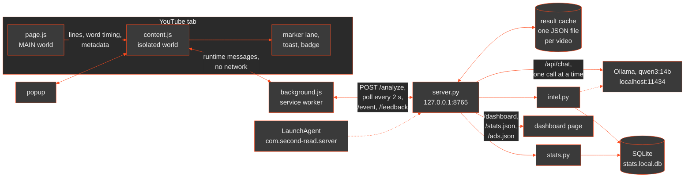
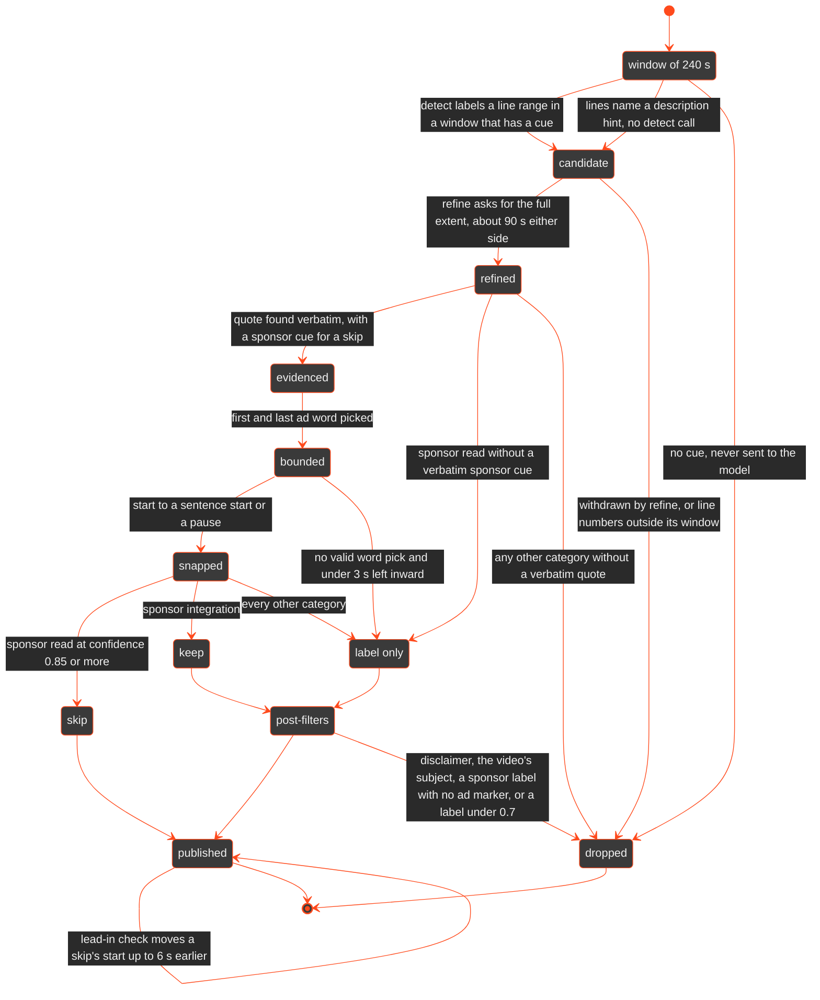

# Second Read

A Chrome extension (Manifest V3) that skips scripted sponsor reads on YouTube
and lets integrated sponsors play.

It works from text alone: the transcript is YouTube's own caption track, read
inside the page, and no audio is downloaded or transcribed. A local Qwen model,
served by Ollama, judges each candidate as a scripted read or an integration
(the creator using the product to do the video's actual task). A segment is
skipped only when the model's evidence quote is found verbatim in the
transcript and contains a sponsor cue; without that it is labeled at most. Cuts
are placed on the caption track's word timing and rounded inward, so a boundary
error leaves a little ad playing instead of removing content.

Built as a personal project and run locally, on one machine, against a local
model. It uses no third-party datasets or APIs (no SponsorBlock) and no API
keys. It is not distributed.

Stack: plain Manifest V3 JavaScript (no bundler, no TypeScript, no npm), a
Python 3 server on the standard library alone, SQLite through `sqlite3`, and
Ollama with `qwen3:14b`.

## How it works



`page.js` runs in the page's own JavaScript world, because the caption tracks
are only reachable through the player object. It hands lines with word timing
to `content.js`, which owns everything visible on the player and applies the
user's settings. Content scripts cannot call localhost, so `background.js` is
the only part that talks to the server, and it forwards one payload untouched.
The server runs one worker thread and one Ollama call at a time, always for the
most recently polled video; a video that is no longer polled is paused between
calls and resumes from the model outputs already on disk. Segments are
published after every window, results are cached by transcript hash, and the
stats and ad-analysis code runs after a job or while the worker is idle, so it
never delays a skip.

Opening a video the server has already analyzed does not wait for any of that:
the extension first asks for the stored result by video ID and, if it was made
by the current pipeline versions, draws the markers and skips by it at once.
If the page reports the same duration and description the result was made
for, and the result was checked against captions within the last week, the
captions are not read at all. Otherwise the caption read runs as
usual and its answer confirms the stored result or replaces it; a stored
result that cannot be checked stops skipping.

```mermaid
%%{init: {'theme': 'base', 'themeVariables': {'primaryColor': '#3A3A3A', 'primaryTextColor': '#F0F0F0', 'primaryBorderColor': '#FF4A1C', 'lineColor': '#FF4A1C', 'secondaryColor': '#2A2A2A', 'tertiaryColor': '#2A2A2A', 'actorBkg': '#3A3A3A', 'actorTextColor': '#F0F0F0', 'actorBorder': '#FF4A1C', 'actorLineColor': '#FF4A1C', 'signalColor': '#FF4A1C', 'signalTextColor': '#F0F0F0', 'noteBkgColor': '#3A3A3A', 'noteTextColor': '#F0F0F0', 'noteBorderColor': '#FF4A1C', 'labelBoxBkgColor': '#3A3A3A', 'labelBoxBorderColor': '#FF4A1C', 'labelTextColor': '#F0F0F0', 'loopTextColor': '#F0F0F0'}, 'sequence': {'mirrorActors': false}}}%%
sequenceDiagram
  participant CS as content.js
  participant PG as page.js
  participant PL as YouTube player
  participant TT as timedtext
  rect rgb(42, 42, 42)
    CS->>PG: getCaptions for this video id
    PG->>PL: getPlayerResponse, until the video id matches
    PL-->>PG: caption tracks
    Note over PG: pick the manual track in the spoken language, else the auto track
    PG->>TT: path A, the track's baseUrl with fmt=json3
    TT-->>PG: empty body, the request carries no proof-of-origin token
    Note over PG,PL: path B
    PG->>PL: wait until the player is ready, let the saved CC preference settle
    PG->>PL: click CC on
    PL->>TT: the player's own request, token attached
    Note over PG: the patched fetch and XHR record that URL as the request starts
    PG->>PL: click CC off before a caption renders, then verify CC state and track
    PG->>TT: the captured URL, retargeted with fmt=json3, tlang dropped, the picked track's lang
    TT-->>PG: json3 events
    PG->>PG: cues merged into lines of up to 8 s, with word timing
    PG-->>CS: lines, language, track kind, path used, title, description
  end
```



Path A costs nothing and would work again if YouTube stopped requiring the
token; today it returns an empty body, so every video goes through path B. If
captions were already on, or the player fires its own request while settling,
that request is used and nothing is clicked. For a non-English video `page.js`
also fetches the English auto-translation (`tlang=en`); detection runs on that
text and the cut is placed on the original track. A video with no caption
track reports `no captions` and the extension does nothing.



A published segment carries the server's default action. The extension then
applies the user's setting for its category (skip, label or off) without
re-analysis, and never skips on a channel in the don't-skip list.

Two rules shape this. The first is that content is never cut. The evidence
gate requires a quote that is in the transcript word for word and, for a skip,
contains a sponsor cue; a sponsor read below 0.85 confidence is a label, not a
skip. The end of a cut is the last ad word minus 0.3 s, and the snap never
moves it past that word into the next sentence. Every fallback moves inward:
if the word pick is invalid twice, the cut shrinks to the inside of the first
and last ad lines, and if less than 3 s would remain the segment is only
labeled. Post-filters can remove a label, never add a skip. One step moves a
boundary outward on purpose: after a skip has been published, a small model
call looks at the one to three sentences before it and, if they are a lead-in
to the ad (a segue, a staged setup, a question about the sponsor), republishes
the skip with an earlier start. It moves by whole sentences, by at most 6
seconds, never before the skip is already out, and any failure, timeout or
unclear answer leaves the start where it was. The second rule is
to fail safe on missing information. A sponsor read is called undisclosed only
when both disclosure signals (YouTube's paid-promotion flag and a sponsor line
in the description) were received and are both negative; if either was not
received, the answer is unknown. The dashboard never accuses a creator on the
strength of a field the client failed to send.

## Coverage

Every category the server can emit. "Verified live" means a human verdict of
`ok` in `server/testset.md`; a segment that only appeared in a run, with nobody
checking it against the video, is "built". Snapshot rows in the regression set
are the pipeline's own output and never count as verified.

| Category | Detected by | Default action | Status |
| --- | --- | --- | --- |
| `sponsor`, scripted read | model (detect, then refine); description-hint fast path; chapter fast path | skip at confidence 0.85 or more with a verbatim sponsor cue, else label | verified live on three videos (Odoo, Incogni, Coddy) |
| `sponsor`, integration | model; needs an ad marker or YouTube's paid-promotion flag, else it is dropped | keep: always plays, not a setting | built; markers seen in real runs, no verdict recorded |
| `selfpromo` | model | label | verified live on one video (newpress.com) |
| `affiliate` | model | label | built |
| `membership` | model | label | built |
| `crosspromo` | model | label | built |
| `charity` | model; a charity paying for the spot is `sponsor` (a rule enforces it when the spot uses sponsorship language) | label | built |
| `giveaway` | model | label | built |
| `interaction` (like, subscribe, bell) | rules: phrases | label | built |
| `intro` | rule: no speech for 4 s or more at the start | label | built; in the regression set, no verdict |
| `outro` | rules: closing phrases in the final 60 s | label | built; in the regression set, no verdict |
| `recap` | rules: "previously", "coming up", and similar | label | built |

The two fast paths are shortcuts into the same pipeline. The hint path
(transcript lines that name a brand, code or link from the description's
sponsor lines go straight to refine) fired in one live run and on synthetic
transcripts. The chapter path (a description chapter titled like an ad, 4
minutes or shorter, becomes a skip from its own bounds with no model call) is
built and has not met a real video.

Three things the pipeline must not do are also verified on the test set: skip
anything in a Hindi vlog with no sponsor (it once did, before the evidence
gate and the 0.85 threshold), mark a "VPN providers sometimes sponsor us"
disclaimer, and mark the product the video is about. A fourth is guarded by
the regression set: a creator narrating their own brand work as part of the
story ("we're shooting for Fossil today") is content. A sponsor label that is
not a skip needs an ad marker (sponsorship language, a call to action, a link,
a code or an offer), or YouTube's paid-promotion flag on the video, or it is
dropped.

## UI

Everything the extension draws comes from one design system (`DESIGN.md`):
monochrome plus one accent, where the accent means live or skip and nothing
else is coloured.

The marker lane is a 4 px strip above YouTube's progress bar, never on it.
Meaning is carried by shape and tone, not colour alone: a skip is a filled
accent bar, an integration is an outline, a label-only segment is dim, and a
low-confidence segment is hatched. Once a segment has been skipped (or you
undid the skip, or seeked into it) its marker drains from accent to dim: it
will not skip again in that page view, and the accent only ever means "this
will skip". Hovering a marker shows a tooltip with the
brand, category, confidence, time range, what will happen, and the evidence
quote.

When playback enters a skip segment the extension seeks to its end and shows a
toast for 6 seconds: brand, category, seconds skipped, a hairline with the
skipped span, the evidence quote, and two buttons. Undo returns to the
pre-skip position. Wrong skip does the same and files a report with the
segment and its evidence. Seeking into a segment by hand marks it handled and
lets it play.

The popup opens on what the extension has done: the time saved all-time, with
today's figure and one line of proof (skips, how many you undid, integrations
left playing). Under it, for the video in the tab, a thin timeline with its
sponsor segments, what happened to each, and the read's code or link with a
Copy button, so skipping the ad does not cost you the offer. Settings come
after: a don't-skip switch for the current channel, the per-category setting
(four categories shown, eight behind a disclosure), and the on/off switch at
the end. A second pane holds the searchable vault of promo codes. "Missed an
ad here" reports the current playhead. A status badge on the player (reading
captions, analyzing 2/4, ready, no ads, no captions, server offline, analysis
failed) is shown in dev mode only.

The dashboard at `http://localhost:8765/dashboard` has three tabs: stats per
brand, creator and category; one card per ad with its position, chapter,
most-replayed curve and measured properties; and aggregates across all ads.
Screenshots of the applied design are in `design/screenshots/`.

<!-- Demo: docs/demo.gif, recorded from a live skip. Not in the repo yet, so the image is commented out.
 -->

## Evaluation

Three kinds of numbers exist, and they are kept apart on purpose.

The stats database is the development log: every segment found and every
skip, undo and report from ordinary use, under whatever versions were running
at the time, including runs from before bugs were fixed. It drives the popup
and the dashboard. It is diagnostic only and is never reported as a result.

`scripts/regress.py` is a regression check, not an accuracy measurement. It
replays `server/testset.json` through the real pipeline from stored
transcripts and stored model outputs, with zero model calls, and checks
expected segments within 1.5 s, that must-not-skip videos have no skip, and
that forbidden ranges stay empty. Its video rows come in three kinds, reported
separately:

- **verified** (13 rows, 9 videos): expectations checked against the video by
  a person, including three variants of one video with different request
  metadata and one with a stand-in English analysis track;
- **transcript-labeled** (5 rows): labeled from a reading of the transcript,
  independent of what the pipeline produced, not checked against the audio by
  a person; never counted as verified. One is an open known issue (the NordVPN
  read in a Hindi video is skipped for 13 of its 69 seconds), printed and
  counted apart;
- **snapshot** (11 rows, 11 videos): what the pipeline produced when the row
  was added, marked `"verified": false, "source": "pipeline-snapshot"`. A
  snapshot row catches a change, not an error: a wrong result snapshotted
  stays wrong until someone labels it;

It also runs 73 rule checks and the extension wiring test. At versions detect
3, refine 3, post 23, lead-in 2 all verified and snapshot rows pass, and every
transcript-labeled row but the known issue. The
expectations were written from the same videos the prompt and thresholds were
tuned on, so a pass says nothing has regressed and nothing about unseen
videos.

The held-out evaluation has not been run. No accuracy figure is claimed
anywhere in this repository. The protocol, when it is run:

1. Collect 20 videos the pipeline has never been run on, from channels
   outside the test set, covering scripted reads, integrations, videos with
   both, non-English videos, and videos with no sponsor.
2. Label them by watching, before running anything: the start and end of
   every sponsor read and integration.
3. Freeze the three pipeline versions, the model tag and the thresholds at a
   git tag. No tuning after the first run.
4. Run each video once through the real extension and server.
5. Report false skips first (any skipped second that is not a scripted read,
   as a count and in seconds), then misses (scripted reads not skipped), then
   boundary error (start and end offsets against the labels), each with the
   list of videos behind it.

### Behavioral tests (synthetic)

`scripts/synth/` holds 25 scenarios (`taxonomy.json`), each written three
times for tuning (DEV) and three more times for one scored run (HELD,
written by separate writers and never read while tuning). `run.py` builds
every file twice, clean (a line per sentence, word timing, punctuation) and
noisy (lowercase, no punctuation, a misheard brand, 8 s lines, no word
timing), sends both to a second server instance running the real model, and
scores them against the scripted truth.

HELD, run once (150 runs):

| | Clean | Noisy |
| --- | --- | --- |
| Runs that cut content, seconds cut | 7 runs, 103.9 s (4 over 1.5 s: 101.9 s) | 31 runs, 163.1 s (12 over 1.5 s: 154.8 s) |
| Scripted reads missed (of 63) | 4 (2 not skipped at all, 2 under half) | 8 (6 not skipped at all, 2 under half) |
| Median start / end error, reads found (+ = later) | 0.0 s / 0.0 s | +1.4 s / 0.0 s |
| Runs passing | 49/75 | 34/75 |

A run passes with nothing missed or mislabeled, at most 1.5 s of content cut,
and a skip that starts at most 4 s late, ends at most 4 s early and leaves no
gap over 4 s. DEV on the same code: 56/75 clean, 42/75 noisy (56→49,
42→34 on HELD). The gap is overfitting to the DEV scripts.

| # | Scenario | Expected | Clean | Noisy | Outcome |
| --- | --- | --- | --- | --- | --- |
| 1 | Classic mid-roll | skip | 3/3 | 2/3 | content cut 5.7 s (noisy overshoot) |
| 2 | Soft segue | skip | 1/3 | 0/3 | late, ad plays (7–12 s) |
| 3 | Question segue | skip | 1/3 | 0/3 | late, ad plays (7–13 s); noisy overshoots ≤ 1.7 s |
| 4 | Cold-open ad | skip | 3/3 | 2/3 | content cut 5.3 s (noisy overshoot) |
| 5 | Two sponsors back to back | skip | 3/3 | 1/3 | noisy: one read missed; 2.5 s cut |
| 6 | Ad after the outro | skip | 1/3 | 1/3 | missed or late, ad plays |
| 7 | No disclosure words | skip | 0/3 | 0/3 | missed or late, ad plays (7–11 s) |
| 8 | Misheard brand | skip | 3/3 | 1/3 | late, ad plays (5–7 s, noisy) |
| 9 | Long read across a window edge | skip | 0/3 | 0/3 | early end or gap, ad plays |
| 10 | Integration | keep | 0/3 | 0/3 | labeled, not kept (plays); **content cut 23.7 s** once (noisy) |
| 11 | Creator's own brand work | none | 3/3 | 3/3 | ✓ |
| 12 | Brand is the subject | none | 3/3 | 3/3 | ✓ |
| 13 | Sponsor disclaimer | none | 2/3 | 3/3 | **content cut 19.3 s** once (clean) |
| 14 | Ad-like content | none | 2/3 | 2/3 | **content cut 22.1 / 27.3 s**, one file, both variants |
| 15 | Self-promo | label | 3/3 | 2/3 | one label missing (noisy) |
| 16 | Affiliate link | label | 3/3 | 3/3 | ✓ |
| 17 | Paid charity spot | skip | 2/3 | 1/3 | late, ad plays (9–10 s); 2.5 s cut once |
| 18 | Non-English read (Hindi) | skip | 1/3 | 1/3 | early end, ad plays; content cut 7.7 s, one file, both |
| 19 | Description disclaimer, no ad | none | 3/3 | 3/3 | ✓ |
| 20 | 'Sponsors' in conversation | none | 3/3 | 3/3 | ✓ |
| 21 | Podcast with sponsors spread out | skip | 2/3 | 0/3 | late or missed, ad plays; 3.4 s cut once |
| 22 | Podcast ad break, reads back to back | skip | 2/3 | 0/3 | **content cut 52.8 s**, one file, both variants; noisy misses |
| 23 | Integration ending in a pitch | keep | 0/3 | 0/3 | pitch skipped, integration unmarked (plays) |
| 24 | Read plus a reminder | skip | 2/3 | 0/3 | missed, ad plays; **content cut 20.6 s** once (noisy) |
| 25 | Disclosure line, no read | noskip | 3/3 | 3/3 | ✓ |

- Synthetic text is cleaner than real captions.
- The noisy twin also drops word timing, harsher than most real auto tracks.
- HELD ran on commit `52e9e3a` (post 22), HELD sha256 `742699…f65a`.
- Since then the three HELD files behind the content cuts in s10, s14 and s22 moved to DEV (`_d4`) and
  fresh ones replaced them (`_h4`, HELD sha256 `d02137…6507`); the numbers above are from the old set.
- This is not the real-video held-out evaluation above.

Speed, on a 24 GB M4 Pro with `qwen3:14b`. Each cell is total job time, time
to the first published skip, and Ollama calls, for a first visit; a revisit is
served from the cache.

| Video | Baseline (versions 1/1/1) | Prefilter, scheduler, merged refine (2/2/1) |
| --- | --- | --- |
| `dU7gCt-7kKk` | 140 s / 140 s / 16 | 59 s / 59 s / 4 |
| `O7LvhSQ5Te4` | 166 s / 166 s / 17 | 89 s / 44 s / 6 |
| `SOQynHuWPeI` | 95 s / 95 s / 9 | 46 s / 39 s / 5 |
| `vGoRpjE-svI` (Hindi, no sponsor) | 71 s / none / 6 | 0 s / none / 0 |

Replayed transcripts without descriptions, 2026-10-13. The current versions
(3/3/6, with one extra call of 4 to 7 seconds per skip for the lead-in check,
after the skip is published) have not been re-timed on replays.

Live first visits the same day, with real request metadata, at versions 3/3/3:

| Video | Job time / first skip / calls | Note |
| --- | --- | --- |
| `tdIUMkXxtHg` | 61 s / 38 s / 4 | 3 of 8 windows sent |
| `SOQynHuWPeI` | 98 s / 33 s / 9 | all 6 windows sent, because of description hints that have since been tightened |
| `vGoRpjE-svI` (Hindi, no sponsor) | 34 s / none / 5 | the added categories now send 4 of its 6 windows |

Per-call latency varies about 2x between runs on this machine, so differences
under 10 s are noise. The full replay table is in `server/testset.md`.

To time one video, replay its cached transcript against a second instance
with an empty data directory (`server.py` reads `SR_PORT` and `SR_DATA_DIR`).
The row appended to that instance's `results.local.md` holds the three
numbers. This needs `server/cache/<videoId>.json`, which is gitignored, so it
only works on a machine that has already analyzed that video. Run it while the
main server is idle: both instances share Ollama, and a call from one delays
the other.

```sh
SR_PORT=8766 SR_DATA_DIR=/tmp/sr-speed python3 server/server.py &
python3 - <<'EOF'
import json, time, urllib.request as u
vid = "SOQynHuWPeI"
c = json.load(open(f"server/cache/{vid}.json"))
api = "http://127.0.0.1:8766/analyze"
body = {"videoId": vid, "lang": c["lang"], "title": c["title"], "lines": c["transcript"], "tag": "SPEED"}
u.urlopen(u.Request(api, json.dumps(body).encode(), {"Content-Type": "application/json"}))
poll = u.Request(f"{api}?v={vid}", headers={"X-SR-Client": "extension"})   # the per-video GETs want this header
while json.load(u.urlopen(poll))["status"] not in ("done", "error"):
    time.sleep(2)
EOF
tail -1 /tmp/sr-speed/results.local.md
kill %1
```

## Local setup

Requirements: macOS (for the LaunchAgent; the server itself is portable),
Python 3.8+, Chrome, [Ollama](https://ollama.com). Node is optional and only
runs the wiring test.

```sh
# 1. Ollama and the model
ollama pull qwen3:14b
ollama pull nomic-embed-text          # optional: the topic-fit metric on the dashboard

# 2. Extension
# chrome://extensions, Developer mode, Load unpacked, choose extension/.
# Copy the ID shown under Second Read (32 letters, a to p).

# 3. Server, as a LaunchAgent locked to that extension
echo "SR_EXTENSION_ID=<the id>" > .env   # gitignored; see .env.example
scripts/install.sh                       # --dry-run prints the plist and changes nothing
curl localhost:8765/health

# After editing server code
launchctl kickstart -k gui/$(id -u)/com.second-read.server
tail -f ~/Library/Logs/second-read.log

# After editing extension files: Reload on the extension card, then refresh the YouTube tab.

# Before every commit
python3 scripts/regress.py

scripts/uninstall.sh                     # stops and removes the agent
```

`install.sh` writes `~/Library/LaunchAgents/com.second-read.server.plist`
with the repository's absolute path and loads it; the agent starts at login
and is restarted if it exits. It takes `SR_EXTENSION_ID` from the environment,
from `.env`, or from a prompt. With the variable set, the server answers only
that extension: a request carrying another extension's `Origin`, or a web
page's, gets a 403. Run `install.sh` again after moving or renaming the
folder, because both the plist path and the extension's ID change with it.

The extension is version 0.5.0. Nothing secret is in the repository; there are
no keys to configure.

## Permissions and privacy

| Permission | Why |
| --- | --- |
| `storage` | Settings, the don't-skip list and the skip counters, in `chrome.storage.local`. |
| Host access to `http://localhost:8765/*` and `http://127.0.0.1:8765/*` | The service worker's requests to the local server. Content scripts cannot make them. |
| Content scripts on `https://www.youtube.com/*` | `content.js` (isolated world) draws the markers and toast and controls the video element. `page.js` (MAIN world, at document start) reads the player's caption tracks. |
| Web-accessible `ui/fonts/*.woff2`, for youtube.com only | The bundled typefaces for the on-player UI, so no font is requested from a third party. |

The extension asks for no `tabs`, `webRequest`, `scripting`, `cookies` or
history permission. What `page.js` does inside the YouTube page is worth
stating exactly: it wraps `fetch` and `XMLHttpRequest` to record the URL of
requests to `/api/timedtext` and nothing else, it may switch captions on for a
moment and back off, and it fetches the caption track with the page's own
YouTube session, which is the request the player itself makes.

Nothing is sent to a third party. The transcript, title, description and
channel go to `127.0.0.1:8765` and from there to Ollama on localhost. The
server refuses requests whose `Host` is not localhost and requests from web
origins. A request with no `Origin` header is still answered, which is how
`curl` and the dashboard reach it, so any process on the machine can read it.
The two endpoints that answer per video ID also require a header that only a
scripted request can carry, so a web page cannot probe which videos have been
analyzed by loading them as images or scripts.

Everything the server writes is under `server/cache/` and is gitignored: one
result file per video with its transcript, `results.local.md` (one row per
analyzed video, which is a viewing history), `feedback.local.jsonl` (Wrong
skip and Missed ad reports) and `stats.local.db`. No row in the stats database
carries a user identity. `.env` and `server/testset.calls.local.json` are
gitignored as well.

## Project layout

```
extension/
  manifest.json     MV3 manifest: two content scripts, service worker, popup
  page.js           MAIN world: caption capture, json3 to lines with word times
  content.js        isolated world: detection, markers, skipping, toast, badge
  content.css       placement of the on-player UI
  background.js     service worker: the only code that talks to localhost
  popup.html/css/js toggle, stats, channel switch, categories, code vault
  ui/               design system: tokens.css, components.css, fonts
  icons/            generated by scripts/make_icons.py
server/
  server.py         API, scheduler, prompts, evidence gate, snapping, cache
  stats.py          SQLite store, brand names, code vault, metrics, dashboard
  intel.py          ad analysis: metrics at job end, model only when idle
  testset.md        test videos, expectations, human verdicts, speed table
  testset.json      the same expectations for scripts/regress.py
  cache/            results, stats DB, results log, feedback (gitignored)
scripts/
  regress.py        regression harness over the test set, in a temp data dir
  wiring_test.js    real content.js, background.js and parser against stubs
  install.sh        installs the LaunchAgent; uninstall.sh removes it
  com.second-read.server.plist  LaunchAgent template
  make_icons.py     writes the extension icons
design/             gallery.html (every UI state), reference boards, screenshots
DESIGN.md           the design language; MERGE_NOTES.md: how it was applied
CLAUDE.md           pipeline specification, constraints, build log
```

## Limitations

Caption capture depends on YouTube internals that are not an API: the player
object's `getPlayerResponse`, the caption-track list inside it, the
`/api/timedtext` request, the proof-of-origin token, and the CC button's
selector. Any of them can change without notice, and when one does the
extension reads no captions and does nothing until `page.js` is fixed.

A video without captions is not analyzed at all. Auto-generated captions
mishear brand names, and some auto tracks carry no word timing; on those the
cut is placed on word times estimated from character position, which is less
exact than a timed track and has not been checked against audio since the
estimate was last changed. When the creator's own captions are used and an
auto track in the same language exists, the text is taken from the former and
the word timing from the latter; that path has unit checks but has not yet
been seen working on a real video.

On a first visit the first skip is published roughly 35 to 60 seconds after
the video opens. A sponsor read that starts inside that window plays. The
target of 25 seconds has only been met by the description-hint fast path, on
a synthetic transcript.

Non-English transcripts cost about twice the tokens per window and ran three
to four times slower in the one Hindi video measured. One language other than
English has been tried.

There is one model, `qwen3:14b`, on one 24 GB machine, with one call at a
time. Its output varies between runs on the same input: the start of one test
read moved between 9:03 and 9:17 because the first pass returned a different
candidate range. Running a smaller model for the first pass kept both models
loaded and exhausted memory on this machine.

An unpacked extension's ID is derived from its folder path. Moving or renaming
the folder resets the extension's settings and counters and makes the server
refuse it until `.env` is updated and `install.sh` is run again.

The lead-in check is a model judgement on a few sentences. It was shaped on
ten sponsor reads and gets those right, which says little about the next
hundred; when it is wrong in the costly direction it removes up to 6 seconds
of content before an ad.

The pipeline has been tested by one person on a small set of channels. The
verified test set is nine videos, the prompt and thresholds were tuned on them, and the
held-out evaluation has not been run. Several categories have never been
checked against a video by a human.

## Status

As of 2026-10-13.

Verified live: caption capture, analysis through the local server with cached
revisits, skipping a scripted read with Undo and manual-seek respect, sponsor
reads on three test-set videos, one self-promo label, and no skip on a video
without a sponsor.

Built, not yet checked against a video by a human: everything else in the
Coverage table and the items under Limitations.

Held-out evaluation: not run.
